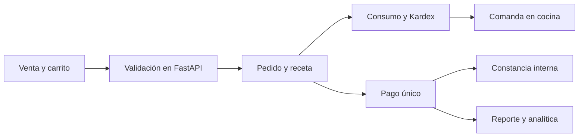

  

# El Paladar del Inka
### Sistema integrado de ventas, cocina, inventario y atención al cliente

**Universidad Continental · Taller de Proyectos 2 · Ingeniería de Sistemas e Informática · 2026**

> **Estado del entregable:** versión de laboratorio funcional, instalada y verificada mediante CI y navegador real. Puede ejecutarse con Docker para demostraciones. **No constituye por sí misma una autorización para operar comercialmente ni para emitir comprobantes SUNAT.**

La implementación utiliza **React 19 + TypeScript + Vite** en el cliente, **FastAPI + Python 3.12 + SQLAlchemy** en la API y **PostgreSQL 17** con migraciones Alembic. La interfaz incluye identidad visual original inspirada en geometrías andinas, fotografías gastronómicas de referencia, navegación adaptada a cada rol y un centro de operaciones con información del servidor.

### Actualización integrada: cierre de caja operativo v6

La [mejora de caja y seguridad de IA](https://github.com/rodo4940/TP2-Grupo11-PaladarInkaIA/pull/18) se encuentra en esta rama. Su ejecución de control: [GitHub Actions · 252 capturas reales](https://github.com/rodo4940/TP2-Grupo11-PaladarInkaIA/actions/runs/45921817602) (segundo intento aprobado). Se verificaron **61 pruebas de backend**, build React/TypeScript, instalación limpia con Docker, controles estáticos y revisión automatizada preliminar de accesibilidad.

**Nuevo:** resumen diario de cobros por fecha `America/Lima`, con diferencias entre efectivo contado y registrado, desglose por efectivo, Yape, Plin y tarjeta, y CSV sin información personal. El conteo manual no se guarda ni aprueba un cierre; los tickets siguen siendo internos. La IA opcional sustituye preguntas libres por intenciones estandarizadas antes de comunicar indicadores agregados a un modelo externo. La supervisión de producción usa el endpoint `/api/v1/ready`, que verifica la conexión con la base de datos. Véase [Operación de caja y requisitos de go-live](docs/OPERACION_CAJA_V6_Y_GO_LIVE.md).

**Estado:** candidato funcional a piloto controlado. Para apertura comercial se exigen UAT firmado, procesos de devolución y arqueo, tratamiento de datos aprobado, respaldos externos/restauración ensayada e integración tributaria autorizada de acuerdo con las obligaciones del establecimiento.

### Experiencia adaptable v7

La versión integrada incluye [rediseño responsive de los doce módulos](docs/RESPONSIVE_V7.md): navegación táctil con foco accesible, tablas operativas como tarjetas legibles en móviles y distribución fluida para teléfonos, tabletas y escritorio. Se validó en **7 tamaños (320–1440 px) con 91 capturas Chromium originales**: [ver ejecución de QA](https://github.com/rodo4940/TP2-Grupo11-PaladarInkaIA/actions/runs/45923342653) y [PR #19 fusionado](https://github.com/rodo4940/TP2-Grupo11-PaladarInkaIA/pull/19). Los resultados se guardan como artefacto descargable desde GitHub Actions, incluidos PNG, hashes SHA-256 y galería HTML. Son pruebas de laboratorio, no UAT empresarial.

## 1. Iniciar el sistema

Descarga la rama **[`release/paladar-inka-v1-piloto`](https://github.com/rodo4940/TP2-Grupo11-PaladarInkaIA/tree/release/paladar-inka-v1-piloto)**. Los archivos de `main` pueden seguir una revisión diferente mientras la promoción a la rama protegida esté pendiente.

**Requisito local:** Docker Desktop o Docker Engine con Docker Compose v2. No es necesario instalar Python, Node.js ni PostgreSQL en el equipo anfitrión.

| Sistema | Instrucción |
|---|---|
| Windows | Inicia Docker Desktop y ejecuta `INICIAR_WINDOWS.bat` |
| Linux, macOS o WSL | `bash scripts/start.sh` |
| Inicio limpio | Consulta [la guía de instalación](docs/INSTALACION_LOCAL.md) y los scripts de arranque |

El iniciador genera un `.env` de desarrollo con secretos locales, levanta los contenedores, aplica migraciones y carga registros **ficticios** de demostración. No compartas ese archivo ni reutilices sus contraseñas.

| Recurso | Dirección local |
|---|---|
| Interfaz web | http://localhost:5173 |
| Documentación interactiva de API (desarrollo) | http://localhost:8000/docs |
| Salud del servicio | http://localhost:8000/api/v1/health |

Usuarios de demostración: `admin`, `cajero`, `cocina`. La contraseña de semilla se consulta en la variable `SEED_ADMIN_PASSWORD` del `.env` **local**, no se guarda en el repositorio.

## 2. Funcionalidades

| Módulo | Qué se puede hacer | Quién lo usa |
|---|---|---|
| Panel general | Consultar ventas cobradas, pedidos, alertas, operaciones y tendencias | Todos los roles, con datos autorizados |
| Ventas / POS | Buscar productos, armar carrito, indicar mesa/recojo/delivery, confirmar pedidos y registrar pagos | Administración y caja |
| Caja y comprobantes | Consultar pagos, filtrar y reimprimir tickets internos `INT-######`; conciliar cobros diarios, comparar efectivo y exportar CSV | Administración y caja |
| Pedidos | Filtrar, consultar seguimiento, revisar estado de pago, detalle y tickets internos | Roles autorizados |
| Cocina | Recibir comandas y mover estados: pendiente → preparando → listo → entregado | Administración y cocina |
| Inventario / Kardex | Consultar existencias, mínimos, consumos por pedido y ajustes autorizados | Administración; consulta según rol |
| Productos y recetas | Crear y mantener productos, precios, disponibilidad, insumos y recetas | Administración |
| Clientes | Gestionar fichas e historial basado en pedidos registrados | Administración y caja |
| Reportes | Consultar ingresos **cobrados**, métodos de pago, artículos vendidos y exportar CSV | Administración y caja |
| Analítica inteligente | Consultar ranking, tendencia orientativa y asistente de preguntas sobre negocio | Administración y caja |
| Usuarios y permisos | Administrar cuentas, roles, activación y bitácora | Administración |
| Configuración | Consultar sesión, estado de la API y actualizar contraseña | Todos los roles |

### Flujo de la operación

El frontend muestra el proceso, pero no determina el importe definitivo: **FastAPI recalcula precios, valida stock y controla las transacciones de la base de datos**. Un usuario sin autorización no obtiene permisos por manipular botones del navegador.

## 3. Caja, tickets y facturación

La tabla de pagos se consulta mediante `GET /api/v1/billing/ledger`. Cada pago tiene una referencia interna estable `INT-######`, con fecha del Perú, productos, cantidades, precios históricos, medio de pago y total. El sistema permite imprimir o reimprimir una constancia sin volver a cobrar. Un cobro duplicado del mismo pedido se rechaza mediante la lógica de negocio del servidor.

**Importante:** los tickets impresos por esta versión son **documentos internos sin validez tributaria**. No son boletas ni facturas electrónicas, no tienen CDR, no se envían a SUNAT y no deben usarse para afirmar cumplimiento fiscal.

Para habilitar una emisión tributaria real el establecimiento debe proporcionar los datos y autorizaciones legales (RUC, régimen, datos de emisor/receptor, esquema de emisión, certificados y validación técnica) e integrar un emisor habilitado. Referencia: [Comprobantes de Pago Electrónicos – SUNAT](https://cpe.sunat.gob.pe/).

## 4. Cómo trabaja el asistente

El servidor admite consultas de análisis por lenguaje natural mediante:
- `GET /api/v1/ai/business-context`: indicadores agregados de ventas, pedidos, insumos y productos.
- `POST /api/v1/ai/ask`: pregunta breve; respuesta razonada, fuente de datos y advertencias.

**Modo local por defecto:** `reglas_explicables_locales`. Funciona sin una clave de terceros, identifica ventas registradas, alertas de insumos, pedidos en cocina y productos vendidos, y explica la base de la respuesta. **No es un modelo generativo entrenado.**

**Modo opcional con modelo externo:** el administrador puede configurar `AI_API_KEY` y `AI_MODEL` exclusivamente en el entorno de la API, nunca en el frontend. El servidor prepara indicadores agregados, no envía contraseñas, JWT, teléfonos ni nombres de clientes, solicita respuesta informativa y vuelve a las reglas locales si el proveedor falla. Requiere contar con credenciales y presupuesto del servicio elegido.

**Seguridad funcional:** el asistente **solo lee datos**. No ejecuta compras, no cambia precios, no altera stock y no confirma pagos. Su cálculo de demanda es descriptivo y no debe presentarse como una predicción estadísticamente validada.

## 5. Interfaz y diseño adaptativo

- Isotipo original del restaurante en SVG: `frontend/src/components/InkaBrand.tsx` y `frontend/public/branding/inka-mark.svg`.
- Fotografía gastronómica referencial de Unsplash, con ilustración local de respaldo si la conexión al CDN falla. Las imágenes no prueban que sean fotografías reales de las recetas del establecimiento.
- Formularios, tarjetas, estados de stock, botones, tablas, filtros, indicadores y tickets con jerarquía visual coherente.
- Navegación inferior en móvil y menú lateral para módulos secundarios. Navegación por rol y accesibilidad de teclado.
- Diseño comprobado en 320, 360, 390, 414, 768, 820, 1280, 1366 y 1440 px en las diferentes ejecuciones. Las tablas anchas se desplazan dentro de su contenedor sin ampliar el documento raíz.

La capa visual actual se implementa en `frontend/src/inka-v5.css` y sus componentes. La [arquitectura y los criterios de uso](docs/SISTEMA_OPERATIVO_V5.md) explican cada decisión relevante.

## 6. Calidad, pruebas y evidencias

Ejecuciones automáticas verificadas para los cambios de la versión v5:

| Verificación | Resultado |
|---|---|
| Tests backend, roles, caja y asistente | **58 aprobadas** |
| Controles HTTP y autorización en navegador | **27/27** |
| Compilación React/TypeScript | Aprobada |
| Instalación desde entorno Docker limpio | Aprobada |
| Escáner estático, dependencias y accesibilidad automática | Aprobados |
| Capturas de Chromium/Playwright | **240 originales** |
| Encuadres adicionales en tamaño exacto del dispositivo | **40** |
| Errores JavaScript no controlados en la matriz nueva | **0 detectados** |
| Desbordamientos horizontales en la matriz nueva | **0 detectados** |

[Ver ejecución íntegra y archivos de evidencia en GitHub Actions](https://github.com/rodo4940/TP2-Grupo11-PaladarInkaIA/actions/runs/45920182835).

La evidencia incluye `GALERIA_240.html`, `MANIFIESTO_SHA256_240.csv`, `REPORTE_EVIDENCIAS_240.json`, `inka-v5-results.json`, controles de seguridad y logs originales. Los PNG se toman con navegador real sobre datos ficticios y se conservan sin alteración. Los 40 encuadres de dispositivo están en `encuadres_viewport/` para su revisión visual; no reemplazan las 240 capturas completas.

La conformidad de axe-core es **preliminar y automatizada**; no constituye certificación integral de WCAG. Estas pruebas tampoco equivalen a pruebas de aceptación UAT de trabajadores del restaurante.

## 7. Documentación adicional

- [Diseño integral, caja, analítica, roles y límites comerciales](docs/SISTEMA_OPERATIVO_V5.md).
- [Instalación local detallada y recuperación ante fallos](docs/INSTALACION_LOCAL.md).
- [Infraestructura y medidas antes de operar comercialmente](deploy/OPERACIONES.md).
- [Registro de evidencias y automatización Playwright](.github/workflows/e2e-full-coverage.yml).
- [Pruebas de lógica de negocio](backend/tests/test_business.py).

## 8. Antes de atender operaciones reales

No emplear esta versión con clientes o pagos del establecimiento hasta validar: pruebas UAT con responsables y firmas auténticas, datos y fotografías autorizados, infraestructura HTTPS y permisos revisados, respaldos con restauración probada, protección de datos personales, evaluación de carga, entrenamiento del personal y **emisión tributaria real independiente** cuando corresponda.

La versión integrada en la rama `release/paladar-inka-v1-piloto` sirve como entregable técnico y demostración reproducible. El repositorio `main` está protegido: su actualización requiere el flujo de revisión correspondiente.

---

**Equipo del proyecto:** Jamil Shandee Hinojosa Ttito · Jose Paolo Champi Palacios · Rodolfo Muñoz Cruz · Erik Alexander Callañaupa Quispe.  
**Asignatura:** Taller de Proyectos 2 · Universidad Continental.

## Funcionalidades v9 (laboratorio y controles internos)

La rama v9 añade facturación **simulada** (boleta, factura y nota de crédito con XML UBL parcial, control de recepción local y SHA-256; **no SUNAT**), modelo predictivo Ridge **realmente entrenado con datos sintéticos**, cierre de caja interno definitivo con SHA-256, copias de seguridad cifradas para instalación autorizada y 16 pruebas UAT **de laboratorio**, diferentes de la aceptación humana del restaurante.

Documentos: [Simulador SUNAT](docs/SUNAT_SIMULADOR_V9.md) · [Modelo ML](docs/MODELO_ML_ENTRENADO_V9.md) · [UAT laboratorio](docs/UAT_LAB_V9_RESULTADOS.md) · [Aprobación y firmas](docs/DECLARACION_APROBACION_V9.md) · [Backups cifrados](docs/BACKUP_CIFRADO_V9.md).

**No confundir cierre técnico con GO-LIVE comercial.** El módulo de laboratorio no emite comprobantes legales, las devoluciones se confirman manualmente y el modelo no predice ventas comerciales sin validación de dataset real.
