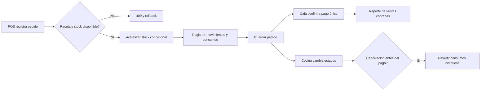
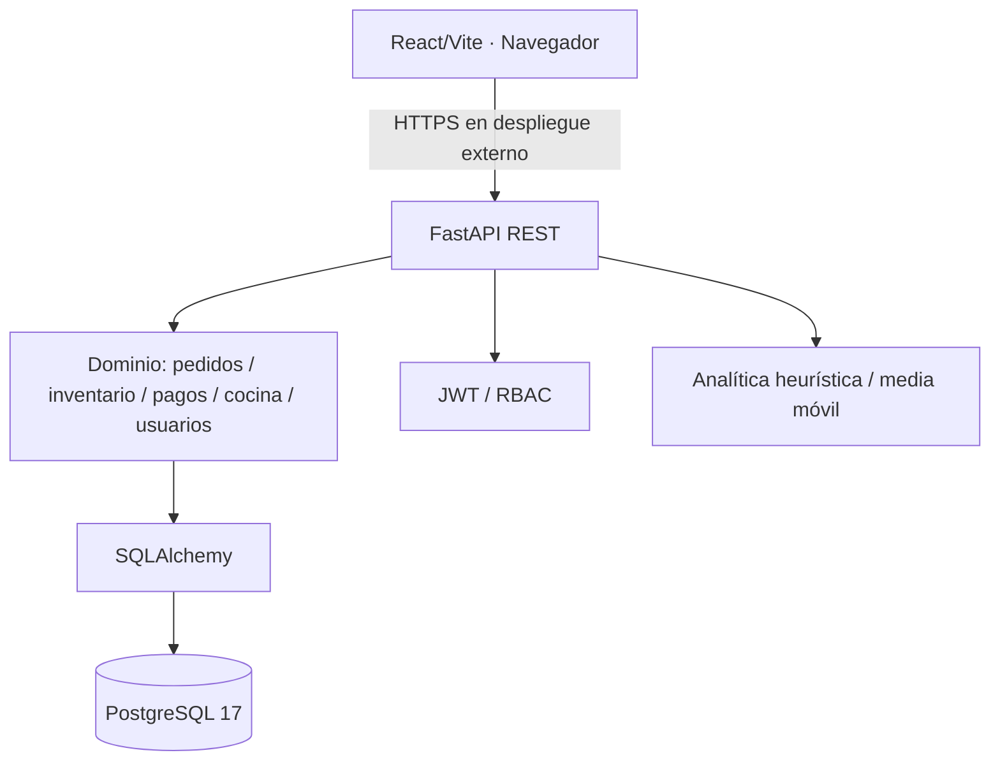

# Decisiones de arquitectura y consistencia

## Alcance

El frontend React (TypeScript) consulta a FastAPI. FastAPI utiliza PostgreSQL 17 como fuente de verdad. La única aplicación activa es este monolito modular integrado; el prototipo independiente anterior se eliminó del árbol de distribución (permanece únicamente en el historial Git). Los datos de instalación automática son ficticios y no representan operaciones de la pizzería.

## Decisiones registradas

| ADR | Decisión | Motivo | Consecuencia |
|---|---|---|---|
| ADR-01 | Monolito modular FastAPI | Equipo pequeño y carga moderada; facilita pruebas y despliegue | Requiere mantener límites de módulos por dominio |
| ADR-02 | PostgreSQL 17 | Transacciones ACID, bloqueos y restricciones de integridad | Migración Alembic obligatoria; respaldos por separado |
| ADR-03 | Precios en céntimos enteros | Elimina redondeo de coma flotante | Conversión de frontend en la frontera de entrada |
| ADR-04 | Consumo de inventario al crear pedido | Detecta insuficiencia inmediatamente | Cancelación restituye cantidades realmente consumidas |
| ADR-05 | Pago único por pedido | Evita doble cobro local | Devoluciones deberán diseñarse posteriormente |
| ADR-06 | JWT + RBAC server-side | El cliente no define los permisos | Secretos, rotación y sesión reforzada antes de producción |
| ADR-07 | Ranking heurístico explicable | No existe dataset auditado para IA entrenada | Declarar límites y plan de evaluación futura |

## Proceso transaccional

## Calidad y riesgos

Seguridad: validar entradas Pydantic, consultas SQLAlchemy, CORS explícito, secretos externos, JWT firmado, rol por endpoint. Esto no equivale a auditoría de pentesting.

Concurrencia: `UPDATE ingredientes SET stock=stock-N WHERE stock>=N` es atómico en PostgreSQL. Un error durante los movimientos provoca rollback de toda la transacción.

Riesgos: cambio de receta después de una venta, reposición indebida, pérdida de conectividad, duplicidad de pagos y acceso no autorizado. Los snapshots de consumo y el constraint único de pago reducen riesgos específicos; otros controles siguen pendientes.

## Diagrama de componentes

## Condiciones de validez

La base principal de desarrollo es PostgreSQL; la base SQLite usada en tests es temporal. No se ha demostrado en esta rama un despliegue público con TLS, backups automáticos, monitoreo 24/7 ni validación con empleados de la pizzería.